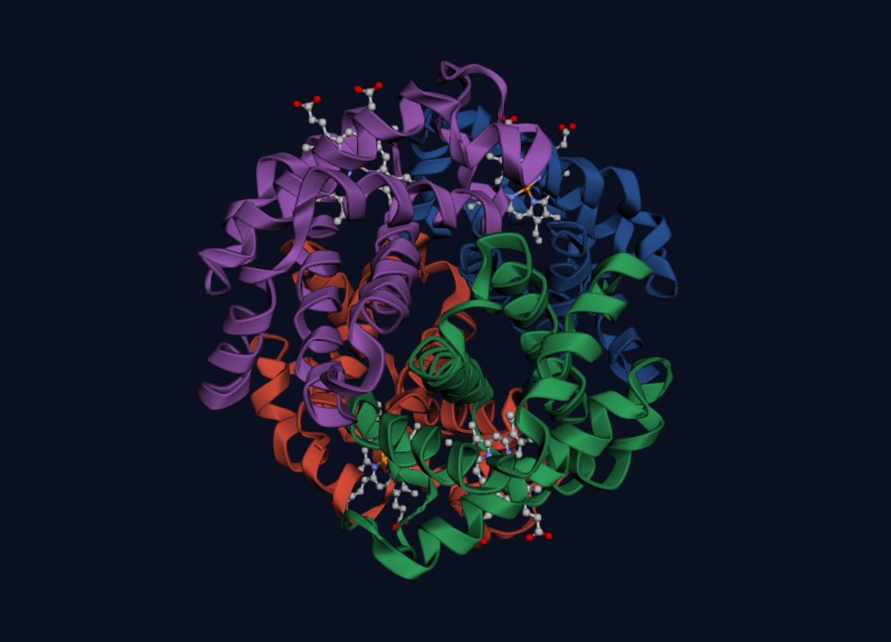
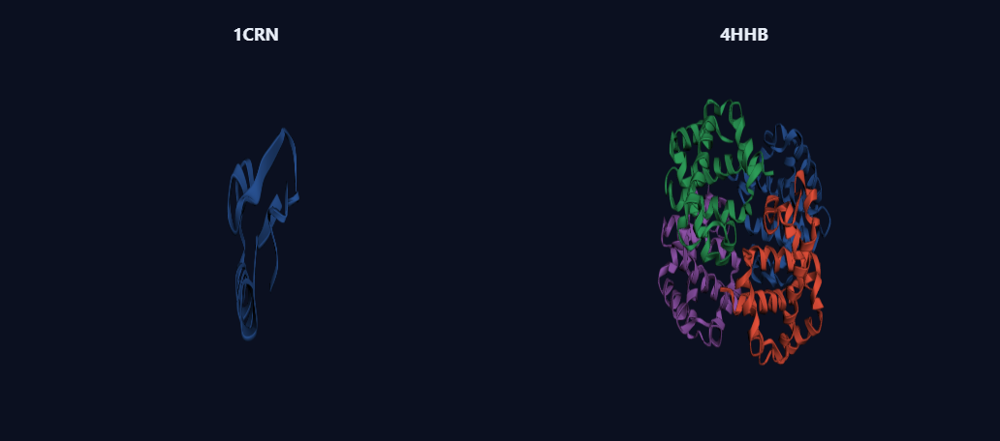

# PEKI Fold

*Protein Exploration Kit for Insights*

Ferramentas de **análise estrutural de proteínas** (formato PDB) desenvolvidas
como Trabalho Final da disciplina de Algoritmos (Doutorado — UFJ), com uma
**aplicação web** que torna as análises visuais e acessíveis pelo navegador.

🔬 **App online:** https://allisonbraz.github.io/PEKI-Fold/ — publicado via GitHub Pages a partir da pasta [`docs/`](docs/).
Exemplos diretos: [1A00](https://allisonbraz.github.io/PEKI-Fold/?pdb=1A00) · [comparar 1CRN e 4HHB](https://allisonbraz.github.io/PEKI-Fold/?compare=1CRN,4HHB).



*Visualização 3D da hemoglobina (1A00) colorida por cadeia, com os grupos HEM em destaque.*



*Modo de comparação: estruturas lado a lado (crambina 1CRN e hemoglobina 4HHB).*

## Funcionalidades

| # | Análise | CLI (Python) | Web |
|---|---|---|---|
| 01/02 | Separação de cadeias | `programa01.py` / `programa02.py` + `separador.py` | ✅ |
| 03 | Estatísticas estruturais (átomos, resíduos, aminoácidos) | `programa03.py` | ✅ |
| 04 | Frequência de aminoácidos + gráficos | `programa04.py` | ✅ |
| 05 | Busca de motivos estruturais | `programa05.py` | ✅ |
| 06 | Detecção de pockets (DoGSite3) | `programa06.py` | ✅ (via API ProteinsPlus) |
| — | Ficha de preparo geométrico | — | ✅ (no navegador; ver [`docs/preparo.md`](docs/preparo.md)) |

## Estrutura do repositório

```
.
├── docs/             # App web estático (GitHub Pages) — análise no navegador
├── pdbproteins/      # Estruturas PDB de entrada (exemplos)
├── programa01..06.py # Programas da atividade (CLI)
├── separador.py      # Módulo de separação de cadeias
├── gerar_relatorio.py# Gera o Relatorio_Final.pdf
├── Relatorio_Final.pdf
└── PRD.md            # Documento de requisitos do produto (roadmap)
```

> As pastas `chainsproteins/`, `graphs/` e `resultados_dogsite/` são **geradas**
> ao executar os programas e por isso não são versionadas.

## App web (recomendado)

Aplicação **100% no navegador** — sem servidor, sem instalação, sem limite de
upload. Cole um código PDB (ex.: `1A00`), o nome da proteína (ex.: `hemoglobin`) ou envie um `.pdb` ou `.cif`, veja a estrutura em
3D e explore a visão geral, cadeias, estatísticas, frequência de aminoácidos, motivos e
**pockets** e uma **ficha de preparo** geométrica (inventário, limpeza do PDB,
íons, dissulfetos, Asn–açúcar e uma caixa editável para o Vina). A detecção de
pockets usa a API oficial do **DoGSiteScorer** (ProteinsPlus/ZBH) chamada direto
do navegador — só requer um código PDB. O nome da proteína não é tratado como código: o RCSB busca em inglês, lista depósitos experimentais e a estrutura só abre depois da escolha. A ficha não faz docking e não calcula
afinidade. O que entra e o que fica de fora da ficha está em [`docs/preparo.md`](docs/preparo.md). A leitura de PDB e mmCIF, as lacunas e a visão geral estão em [`docs/estrutura.md`](docs/estrutura.md). A aba Qualidade e a anotação de componentes estão em [`docs/qualidade.md`](docs/qualidade.md).

Também é possível **comparar de 2 a 4 proteínas** lado a lado (estatísticas,
aminoácidos e pockets cross-protein, com as 5 perguntas do trabalho respondidas
entre as proteínas).

Testar localmente:
```bash
cd docs
python -m http.server 8080   # abre http://localhost:8080
```

Detalhes e instruções de publicação: [`docs/README.md`](docs/README.md).

## Programas em Python (CLI)

Requer Python 3 (e `pandas`, `matplotlib`, `reportlab` para os programas 03–06 e
o relatório). Execução típica:
```bash
python programa01.py          # separa as cadeias em chainsproteins/
python programa03.py          # estatísticas
python programa04.py          # frequência + gráficos em graphs/
python programa05.py GLY-LYS-SER
python gerar_relatorio.py     # gera Relatorio_Final.pdf
```

## Tecnologias

- **Web:** HTML/CSS/JS estático (sem backend), [3Dmol.js](https://3dmol.csb.pitt.edu/) (viewer 3D),
  [Plotly](https://plotly.com/javascript/) (gráficos) e [jsPDF](https://github.com/parallax/jsPDF)
  (exportação), via CDN.
- **CLI:** Python (pandas, matplotlib, reportlab).
- **Dados:** estruturas e metadados do [RCSB PDB](https://www.rcsb.org/);
  pockets via [DoGSiteScorer/ProteinsPlus](https://proteins.plus/).

## Citações

Somente trabalhos cujo DOI foi conferido no Crossref:

- Volkamer, A.; Kuhn, D.; Grombacher, T.; Rippmann, F.; Rarey, M. Combining global and local measures for structure-based druggability predictions. *J. Chem. Inf. Model.* **2012**, *52* (2), 360–372. https://doi.org/10.1021/ci200454v
- Volkamer, A.; Kuhn, D.; Rippmann, F.; Rarey, M. DoGSiteScorer: a web server for automatic binding site prediction, analysis and druggability assessment. *Bioinformatics* **2012**, *28* (15), 2074–2075. https://doi.org/10.1093/bioinformatics/bts310
- Fährrolfes, R.; Bietz, S.; Flachsenberg, F.; Meyder, A.; Nittinger, E.; Otto, T.; Volkamer, A.; Rarey, M. ProteinsPlus: a web portal for structure analysis of macromolecules. *Nucleic Acids Res.* **2017**, *45* (W1), W337–W343. https://doi.org/10.1093/nar/gkx333
- Schöning-Stierand, K.; Diedrich, K.; Fährrolfes, R.; Flachsenberg, F.; Meyder, A.; Nittinger, E.; Steinegger, R.; Rarey, M. ProteinsPlus: interactive analysis of protein–ligand binding interfaces. *Nucleic Acids Res.* **2020**, *48* (W1), W48–W53. https://doi.org/10.1093/nar/gkaa235
- Rego, N.; Koes, D. 3Dmol.js: molecular visualization with WebGL. *Bioinformatics* **2015**, *31* (8), 1322–1324. https://doi.org/10.1093/bioinformatics/btu829
- Berman, H. M. et al. The Protein Data Bank. *Nucleic Acids Res.* **2000**, *28* (1), 235–242. https://doi.org/10.1093/nar/28.1.235
- Trott, O.; Olson, A. J. AutoDock Vina: improving the speed and accuracy of docking with a new scoring function, efficient optimization, and multithreading. *J. Comput. Chem.* **2010**, *31* (2), 455–461. https://doi.org/10.1002/jcc.21334
- Eberhardt, J.; Santos-Martins, D.; Tillack, A. F.; Forli, S. AutoDock Vina 1.2.0: new docking methods, expanded force field, and Python bindings. *J. Chem. Inf. Model.* **2021**, *61* (8), 3891–3898. https://doi.org/10.1021/acs.jcim.1c00203

O PEKI Fold não executa o Vina. A citação vale só para o formato editável da caixa sugerida. O ano de 3Dmol.js e o do Vina de 2010 seguem a data de impressão do periódico; o DOI é o mesmo da versão online.

## Autoria

Desenvolvido por **Allison Braz** na **Universidade Federal de Jataí (UFJ)**,
sob orientação do **Prof. Dr. Roosevelt Alves da Silva**, como Trabalho Final da
disciplina de Algoritmos (Doutorado).

## Licença / créditos

Projeto acadêmico. Detecção de pockets baseada no DoGSite3 (ZBH, Universidade de
Hamburgo) — ver `PRD.md` para o plano de integração.
